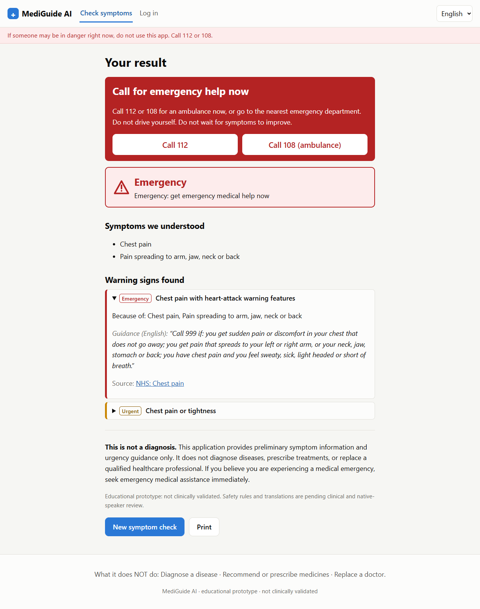
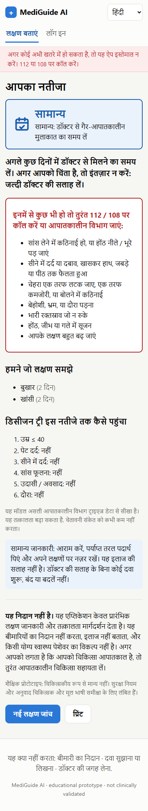
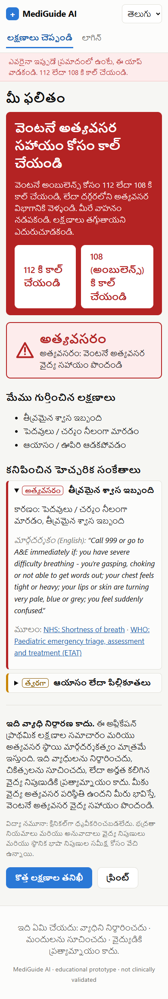
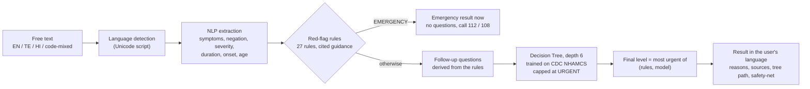

# MediGuide AI

**Multilingual symptom analysis and medical-urgency guidance in English, Telugu and Hindi.**

A patient describes symptoms in their own words. MediGuide extracts the symptoms, checks emergency warning signs
against cited clinical guidance, asks only the follow-up questions that could change the outcome, and recommends
**Emergency**, **Urgent** or **Routine** care with a plain-language explanation.

> ⚠️ **Educational prototype, not clinically validated, not a medical device.** It does not diagnose, prescribe or
> replace a doctor. In an emergency, call **112** or **108** (India).

| English: emergency result | Hindi (mobile): routine result | Telugu (mobile): emergency |
|---|---|---|
|  |  |  |

---

## How it works



**Safety design (each point is enforced by a test):**
1. **Rules first, rules decide emergencies.** The red-flag engine runs before, and independently of, the ML model. The `safety` package never imports ML code; an AST test checks this.
2. **ML can only raise urgency, never lower it.** The final level is the more urgent of the rule level and the model level. The model is capped at URGENT, because its emergency precision is only ~0.25.
3. **No machine translation in the safety path.** Telugu, Hindi and English phrases map to shared concept IDs. All result text comes from fixed, reviewable templates.
4. **Never falsely reassuring.** Unrecognised text gets an emergency checklist and then URGENT. Missing age gives at least URGENT. Every non-emergency result carries "call 112 if…" safety-netting.
5. **Emergencies never wait.** No follow-up questions are asked once a warning sign is found.

More detail: [docs/architecture.md](docs/architecture.md) (system, data-flow, use-case, database and model diagrams).

## Results (honest summary)

All text-based evaluations use **synthetic, developer-written sentences**. The ML evaluation uses **real CDC emergency-department triage data**.
Reported numbers come from **blind runs**, taken before any fixes. Full details: [docs/testing.md](docs/testing.md).

| Experiment | What was measured | Result (blind run) |
|---|---|---|
| 1. English extraction | 30 held-out sentences | F1 **0.932**, 86.7% fully correct |
| 2. Telugu / Hindi extraction | 20 held-out sentences each | F1 **1.000** (TE, likely inflated: same author) / **0.936** (HI) |
| 3. Decision Tree vs Random Forest | NHAMCS 2022 test set, 8,491 ED visits | Macro-F1: DT **0.515**, RF **0.538**, majority baseline 0.236 |
| 3. App policy (rules + depth-6 DT) | same | **91.6%** of nurse-triaged emergencies get ≥ Urgent; **8.4%** get Routine |
| 4. Emergency warning detection | 68 cases in EN/TE/HI | Emergency recall **34/34**; 2 Hindi URGENT cases under-triaged (fixed) |
| 5. Follow-up questions | 28 cases | **28/28** (right questions asked, unnecessary ones avoided) |
| 6. Application testing | automated | **329** backend tests, **19** frontend tests, **9/9** real-browser steps (Edge, run before Phase 12) |

**Key finding:** with only self-reported information (symptoms, age, pain, and no vital signs), the model separates
Routine from Urgent only weakly. That is why the cited safety rules, and not the model, decide emergencies.

## Data
- **CDC NHAMCS Emergency Department public-use files, 2016–2022:** 123,040 visits, of which 84,148 have a nurse triage level. Public domain. Training uses 2016–2021; the 2022 data is a locked temporal test set.
- **Semigran et al. (2015) symptom-checker vignettes**, with gold triage labels via Zenodo (CC BY 4.0). Used as an external reference.
- **No disease-prediction dataset is used for labels.** Urgency labels come only from real triage decisions.

Details, links, licences and limitations: [data/DATASETS.md](data/DATASETS.md).

## Tech stack

| Layer | Technology | Why |
|---|---|---|
| NLP | spaCy (token Matcher), NegEx-style rules, regex | Transparent, testable, works without labelled Indic training data |
| Indian languages | Indic NLP Library, Unicode script detection | Normalisation and tokenisation for Telugu and Devanagari |
| Knowledge | YAML vocabulary (71 concepts; ~520 EN, ~220 TE, ~270 HI terms), 27 cited rules, EN/TE/HI templates | Reviewable by clinicians and native speakers without reading code |
| ML | scikit-learn Decision Tree (+ Random Forest comparison) | Explainable decision path, at most 6 conditions per result |
| Backend | FastAPI, Pydantic, SQLAlchemy, SQLite | Validated API with interactive docs at `/docs` |
| Security | Argon2id, JWT in an httpOnly cookie, Fernet encryption, rate limiting | Protects health data at rest and user accounts |
| Frontend | React 19, Vite, React Router, i18next | Responsive, accessible, three interface languages |
| Testing | pytest, Vitest + Testing Library, Playwright (Edge) | Unit, API, component and real-browser tests |

## Project structure
```
mediguide-ai/
├── backend/
│   ├── mediguide/           core engine (no web code)
│   │   ├── nlp/             extraction, negation, attributes
│   │   ├── multilingual/    language detection, Telugu/Hindi normalisation
│   │   ├── safety/          red-flag rule engine (independent of ML)
│   │   ├── ml/              features (shared train/serve), labels, predictor
│   │   ├── followup/        rule-derived follow-up questions
│   │   └── recommend/       final level + explanation
│   ├── api/                 FastAPI app: auth, assessment, history, admin
│   └── tests/               pytest (329 tests)
├── frontend/                React app (Vite), 13 component tests
├── knowledge/               symptoms.yaml, red_flags.yaml, nlp_cues.yaml, templates.yaml
├── models/                  dt_app_v1 (app model) + metadata, MODEL_CARD.md
├── data/                    DATASETS.md, synthetic test sets (raw/processed are git-ignored)
├── scripts/                 download, prepare, train, evaluate, e2e browser test, admin tools
├── reports/                 experiment reports and figures
└── docs/                    architecture, backend, frontend, testing, clinical review log
```

## Install and run (Windows; macOS/Linux use the same steps with `/` paths)

**Requirements:** Python 3.12+ (tested on 3.14) and Node.js 20+ (tested on 24).

**1. Backend**
```powershell
cd mediguide-ai
python -m venv .venv
.\.venv\Scripts\Activate.ps1
pip install -r backend\requirements.txt
cd backend
uvicorn api.main:app --reload
```
The first start creates `.env` with the signing and encryption keys. **Never commit it.**
API docs: http://localhost:8000/docs

**2. Frontend** (in a second terminal)
```powershell
cd mediguide-ai\frontend
npm install
npm run dev
```
Open **http://localhost:5173**.

**3. Optional:**
- Make an admin: `python scripts\create_admin.py you@example.com`
- Demo statistics for the dashboard: `python scripts\seed_demo_stats.py` (synthetic, **not** real usage)

**4. Reproduce the data and models** (optional; the app model is already included):
```powershell
python scripts\download_nhamcs.py      # ~20 MB from CDC
python scripts\prepare_nhamcs.py
python scripts\explore_nhamcs.py
python scripts\prepare_vignettes.py
python scripts\train_models.py         # ~15 minutes (grid search)
```

**5. Tests**
```powershell
cd backend;  python -m pytest -q                 # 329 tests
cd frontend; npm test                            # 13 tests
pip install -r backend\requirements-dev.txt
python scripts\e2e_browser.py                    # real Edge browser, 9 steps, screenshots
python scripts\eval_extraction.py data\synthetic\te_extraction_heldout.yaml --lang te
python scripts\eval_safety.py
python scripts\eval_followup.py
```

## Limitations
- **Not clinically validated.** The safety rules and the Telugu/Hindi wording are **pending clinician and native-speaker review** ([docs/clinical_review_log.md](docs/clinical_review_log.md)).
- **The model learned from US emergency-department visits** (no self-care cases, no vital signs used). It has not been validated for Indian patients.
- **Text matching is vocabulary-based.** Phrasings outside the vocabulary are missed. Romanised Hindi/Telugu ("mujhe bukhar hai") is not supported.
- **The test sentences were written by the developer**, so the NLP scores are upper bounds. Real patient messages would score lower.
- **Prototype infrastructure:** SQLite, in-memory rate limiter, no email verification or password reset.

## Responsible use
MediGuide gives **urgency guidance only**. It never names a disease, never suggests medication, and always shows:
> *This application provides preliminary symptom information and urgency guidance only. It does not diagnose diseases,
> prescribe treatments, or replace a qualified healthcare professional. If you believe you are experiencing a medical
> emergency, seek emergency medical assistance immediately.*

**Clinical sources** for the rules: NHS, NICE NG143, WHO ETAT, MedlinePlus, Tele-MANAS (MoHFW). See `knowledge/red_flags.yaml`.
**Data:** CDC/NCHS NHAMCS (public domain). Semigran et al., BMJ 2015;351:h3480. Schmieding et al. 2022 (Zenodo 10.5281/zenodo.6054093).
