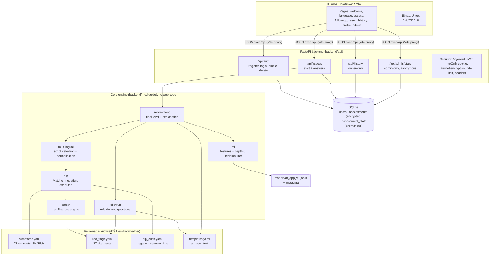
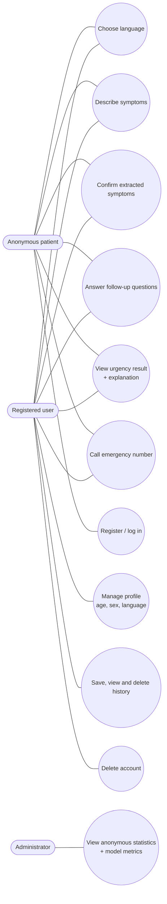
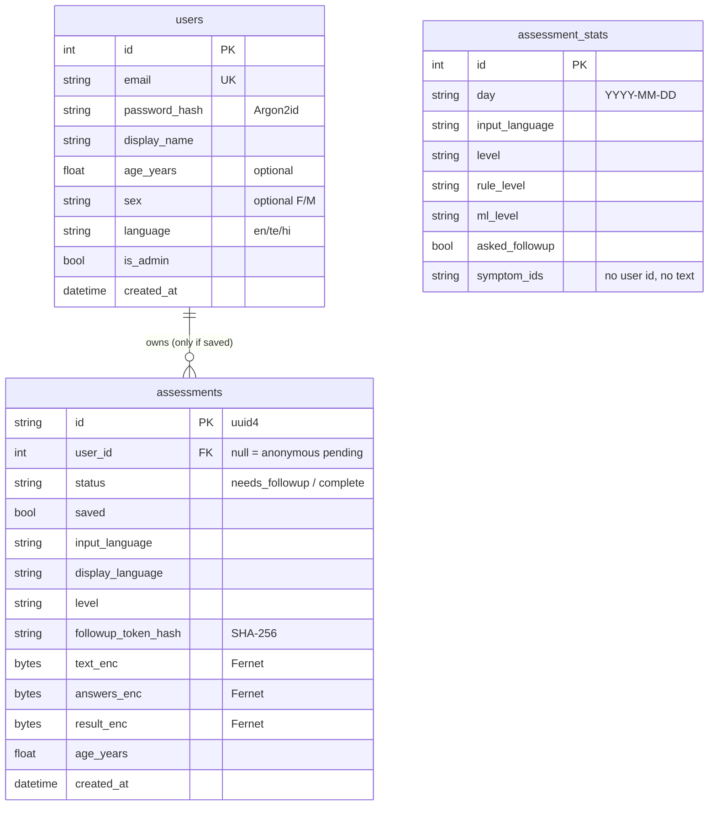
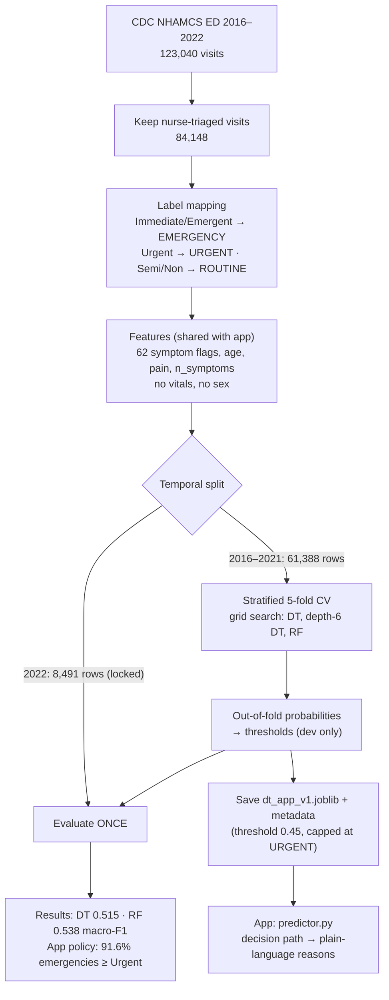
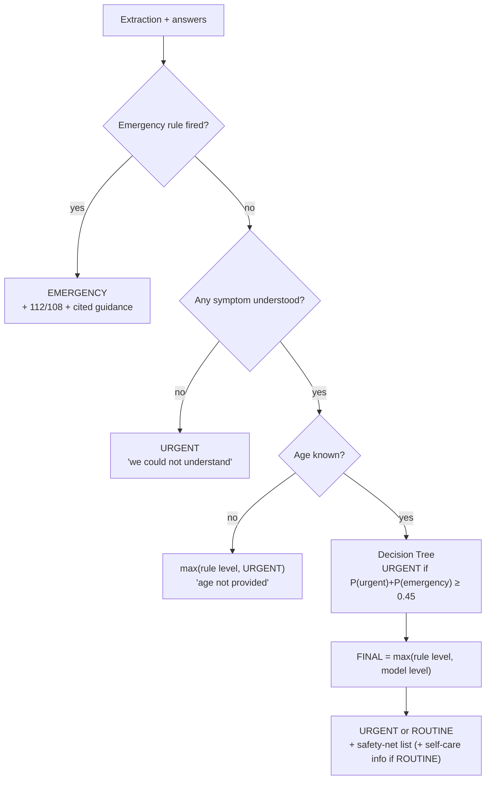

# MediGuide AI: architecture

All diagrams are Mermaid, so GitHub renders them automatically. To export one as an image, paste it into https://mermaid.live.

## 1. System architecture



**Independence rule:** `safety` never imports `ml` (an AST test enforces this). The web layer (`api`) only calls the
engine's single entry point, `recommend.engine.assess()`.

## 2. Data flow of one assessment

```mermaid
sequenceDiagram
    actor P as Patient
    participant F as React app
    participant A as FastAPI
    participant E as Engine
    participant D as Database

    P->>F: Describes symptoms (any language)
    F->>A: POST /api/assess {text, age?, display_lang, save?}
    A->>E: assess(text)
    E->>E: detect language, normalise, extract symptoms
    E->>E: red-flag rules
    alt Emergency warning sign
        E-->>A: EMERGENCY result (no questions)
        A->>D: anonymous stats row (+ encrypted record if saved)
        A-->>F: result
        F-->>P: Call 112 / 108 banner, reasons, sources
    else No emergency yet
        E-->>A: needs_followup + questions
        A->>D: pending record (encrypted text, token hash, expires in 60 min)
        A-->>F: questions + one-time token
        F-->>P: "We understood: …" + questions
        P->>F: Answers
        F->>A: POST /api/assess/{id}/answers {answers, token}
        A->>E: assess(text, answers)
        E->>E: rules again, then Decision Tree (capped at URGENT)
        E-->>A: final = most urgent(rules, model)
        A->>D: stats row; keep encrypted record only if saved, else delete
        A-->>F: result
        F-->>P: level, next step, reasons, tree path, safety-net
    end
```

## 3. Use cases



## 4. Database schema



## 5. Model workflow



## 6. Final-level decision logic


