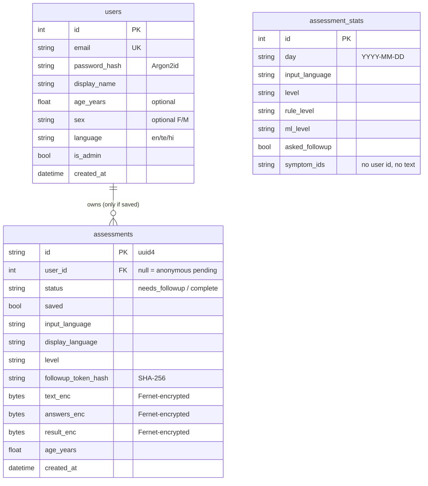

# Backend (FastAPI): how to run, endpoints, database, security

## Run it

From the `backend` folder, run these commands one at a time:

```powershell
cd C:\Users\donep\mediguide-ai\backend
..\.venv\Scripts\Activate.ps1
uvicorn api.main:app --reload
```

Open **http://localhost:8000/docs** to try every endpoint in the browser (Swagger UI).

The first start creates `.env` in the project root with two random keys: one signs logins, the other
encrypts stored health data. **Never commit or share this file.** If you lose the encryption key, saved
assessments can no longer be read.

**To make an administrator:** first register an account, then run
`python scripts\create_admin.py you@example.com`.

## Endpoints

| Method | Path | Who | Purpose |
|---|---|---|---|
| GET | `/api/health` | anyone | Server is up |
| GET | `/api/meta` | anyone | Languages, disclaimer, levels, emergency numbers, model version |
| POST | `/api/auth/register` | anyone | Create account (email, password ≥ 8 characters) and log in |
| POST | `/api/auth/login` · `/logout` | anyone | Session cookie on / off. 5 failed logins → 15-minute block |
| GET / PUT / DELETE | `/api/auth/me` | logged in | View / update profile (age, sex, language) / **delete account and all data** |
| POST | `/api/assess` | anyone | Start an assessment. Returns the result or follow-up questions |
| POST | `/api/assess/{id}/answers` | owner | Submit answers. Anonymous users must send the `followup_token` |
| GET | `/api/history` | logged in | List own saved assessments |
| GET / DELETE | `/api/history/{id}` | owner | View / delete one saved assessment |
| DELETE | `/api/history` | logged in | Delete all own assessments |
| GET | `/api/admin/stats` | admin | Anonymous totals, top symptoms, languages, model metrics |

**Example body for `POST /api/assess`:**
`{"text": "నాకు ఛాతీ నొప్పి ఉంది", "lang": null, "display_lang": null, "age_years": 45, "save": false}`

## Database schema (SQLite, `data/app/mediguide.db`)



**What is kept:**
- **Anonymous user:** nothing identifiable after the assessment ends. A pending follow-up row is deleted when it is answered, or after 60 minutes.
- **Logged-in user:** a row is kept only when "save to history" is ticked.
- **Statistics:** every completed assessment adds one anonymous `assessment_stats` row.

## Security and privacy measures

| Requirement | Implementation |
|---|---|
| Password storage | Argon2id hashes; same timing for unknown email and wrong password |
| Sessions | JWT (HS256, 8 h) in an **httpOnly, SameSite=Lax** cookie; `Secure` flag when `MEDIGUIDE_COOKIE_SECURE=true` |
| Brute force | 5 failed logins per email per 15 minutes |
| Health data at rest | Symptom text, answers and results encrypted with Fernet |
| Access control | History and pending assessments are checked against the owner; another user gets 404, never "forbidden" (does not reveal that an id exists) |
| Anonymous follow-ups | Random one-time token; only its SHA-256 hash is stored |
| Input validation | Pydantic: text 2–2000 characters, language en/te/hi, age 0–120, strict answer format |
| Admin data | Reads only the anonymous stats table; groups smaller than 5 are shown as "<5" |
| Data deletion | Delete one item, all history, or the whole account (cascade) |
| Transport | Use HTTPS in production (reverse proxy); HSTS header sent when secure cookies are on |
| Headers | `nosniff`, `X-Frame-Options: DENY`, `no-referrer`, `Cache-Control: no-store` |
| Errors and logs | Generic 500 messages; logs never contain symptom text |
| Third parties | None. No analytics, no external translation API, no cloud model calls |

**Limitations (prototype):**
- The rate limiter lives in memory, so it doesn't work across several server processes.
- There is no email verification and no password reset.
- SQLite is single-file. Use PostgreSQL for a real deployment.
- Encryption keys live in `.env`. Use a secrets manager in production.

## Tests (Experiment 6, backend part)

Run `python -m pytest tests/test_api.py` in `backend`. **29 API tests**, all passing, cover:
- registration, login and logout;
- anonymous and saved assessments, and the follow-up flow;
- input validation;
- the httpOnly cookie, password hashing, rate limiting and admin-escalation attempts;
- encryption at rest, cross-user access, deletion, expiry of pending data and the admin privacy checks.
